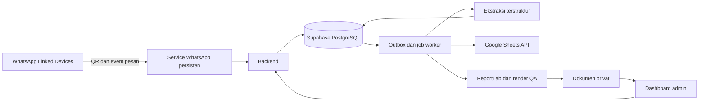

# Rencana Dashboard PO Laiora

Status: rancangan revisi2 dengan implementasi operasional tersedia di source; lihat PANDUAN_OPERASIONAL.md untuk aktivasi005–006 dan batas integrasi hosted. Tanggal: 16 Oktober 2026.
Sumber aturan bisnis: [MASTER SOP di README](../README.md).

## 1. Tujuan dan batas pekerjaan

Membuat dashboard untuk mencatat, mencari, dan memantau pre-order pelanggan; menerima pesan melalui koneksi WhatsApp Linked Devices melalui QR; membantu admin mengubah percakapan menjadi draft order; serta merekam data operasional ke Google Sheets.

Spreadsheet tujuan yang diberikan pemilik:
https://docs.google.com/spreadsheets/d/1KTxNabq2oEw-kevJEBj2J4BZ7ZTd21fisIALeGkXMs0/edit

Struktur, isi, dan izin spreadsheet belum diperiksa. Dokumen ini tidak menyatakan akun sudah terhubung, data sudah tersinkron, atau pesan pelanggan sudah dapat dibaca. Pekerjaan tahap ini hanya perencanaan; belum ada perubahan ke spreadsheet atau akun WhatsApp.

### Lingkup MVP

- Satu akun login untuk seluruh halaman divisi; tidak ada username per divisi.
- Dashboard ringkasan, listing order, pencarian, filter, dan detail order.
- Input manual atau tempel form WhatsApp sejak awal, sebelum integrasi akun tersedia.
- Katalog, harga, normalisasi, kalkulasi, dan revisi sesuai SOP.
- Halaman Tracking Chat untuk pesan dari koneksi QR, label produk, serta status Belum PO / Sudah PO.
- Asisten ekstraksi percakapan menjadi draft yang ditinjau admin.
- Pencatatan pembayaran, produksi, dan pengiriman secara terpisah.
- Konfirmasi WhatsApp yang dapat disalin dan Delivery Order PDF sesuai SOP.
- Sinkronisasi data operasional ke spreadsheet tujuan, dengan status dan pemulihan kegagalan.
- Rekap produksi, pengiriman, dan riwayat perubahan.

### Tahap lanjutan

- Mengirim balasan atau template WhatsApp langsung dari dashboard setelah kebijakan pengiriman disepakati.
- OCR bukti transfer, transkripsi voice note, dan ekstraksi gambar.
- Integrasi payment gateway, kurir, stok bahan baku, dan perhitungan kapasitas dapur.
- Impor histori WhatsApp bila ada sumber dan mekanisme resmi yang mendukungnya.

MVP tidak menganggap bukti transfer sebagai pembayaran terverifikasi otomatis, dan tidak mengirim balasan pelanggan secara otomatis.

## 2. Satu akun, halaman per divisi

Satu akun login digunakan untuk seluruh aplikasi. Tidak ada akun, undangan, atau role terpisah untuk divisi. Halaman Produksi, Pengiriman, Pembayaran, dan Tracking Chat dipisah lewat navigasi. Semua halaman tetap memerlukan login.

Pemisahan halaman bukan pembatasan akses: siapa pun yang memakai akun tersebut dapat membuka semua halaman. Audit mencatat akun bersama, waktu, dan sesi; sistem tidak bisa memastikan orang yang melakukan perubahan. Beberapa sesi tetap harus aman dari konflik pembaruan dan nomor ganda.

## 3. Requirement fungsional

| ID | Requirement | Kriteria penerimaan |
|---|---|---|
| FR-01 | Listing pemesanan | Bisa filter tanggal kirim, status, kurir, dan kelengkapan; cari nomor order, nama, atau HP; hasil memiliki pagination |
| FR-02 | Input order | Bisa tambah manual/tempel form; simpan teks asli; preview hasil normalisasi sebelum konfirmasi |
| FR-03 | Kalkulasi | Harga dari katalog; quantity unit fisik; kartu terpisah; ongkir null berbeda dari 0; total dihitung di server |
| FR-04 | Penomoran | Nomor YY-#### unik dan diberikan dalam transaksi saat draft dikonfirmasi; tanggal wajib ada; revisi/reprint tidak mengambil nomor baru |
| FR-05 | Revisi | Nomor tetap; ada versi, pelaku, waktu, dan perubahan; dokumen/rekap produksi memakai versi terbaru |
| FR-06 | Status | Kelengkapan, pembayaran, produksi, dan pemenuhan terpisah; pembuatan PDF tidak mengubah status pembayaran |
| FR-07 | Inbox | Tampilkan kontak, pesan, waktu, dan status pemrosesan; event pesan duplikat tidak membuat pesan/order ganda |
| FR-08 | Asisten order | Hasil ekstraksi menjadi draft; field penting punya rujukan pesan; ambiguitas ditandai; admin bisa koreksi sebelum konfirmasi |
| FR-09 | Percakapan lanjutan | Pesan baru bisa dihubungkan ke order atau usulan revisi; satu kontak boleh memiliki beberapa order; tidak memilih order hanya dari nomor HP |
| FR-10 | Pembayaran | Catat nominal, tanggal, referensi/bukti, dan petugas konfirmasi; hitung pembayaran terkonfirmasi dan sisa tagihan |
| FR-11 | Dokumen | Konfirmasi mengikuti format SOP; PDF 100×150 mm tanpa harga, fee, pemesan, atau isi kartu; logo asli dan visual QA wajib |
| FR-12 | Sheets | Setiap perubahan operasional tersimpan masuk antrean sinkronisasi; upsert berdasarkan ID tetap; ada waktu sinkron terakhir dan retry |
| FR-13 | Rekap | Rekap dapur per tanggal/produk/ukuran memakai revisi terbaru dan mengecualikan order batal; pengiriman menampilkan penerima/alamat/instruksi |
| FR-14 | Audit | Perubahan harga, order, pembayaran, status, dan konfigurasi tercatat; order dibatalkan tanpa menghapus jejak |
| FR-16 | Tracking Chat | Filter produk dan Belum PO / Sudah PO; label bisa dikoreksi; nomor order terkait dapat dibuka; status PO berasal dari order tersimpan, bukan tebakan AI |
| FR-15 | Kesehatan integrasi | Pengguna bisa melihat koneksi, event gagal, backlog Sheets, dan menjalankan ulang sinkronisasi tanpa menggandakan data |

### Aturan bisnis yang harus dipertahankan

- Harga dan alias produk mengikuti README; harga satuan disimpan pada item order agar perubahan katalog tidak mengubah histori.
- Greeting Card yang belum dipilih tidak dikenai biaya; pilihan Tidak mengalahkan isi kartu lama.
- Potong 9 tetap satu cake. Ukuran default mengikuti SOP.
- Ongkir belum diketahui membuat grand total belum final; jangan simpan sebagai nol.
- Koreksi hari mengikuti tanggal kalender. Tanggal relatif memakai zona waktu bisnis yang dikonfirmasi.
- Snapshot nomor berikutnya 26-0380 pada README bukan penghitung live. Nomor terakhir harus diverifikasi sebelum impor/aktivasi.
- Reset sequence saat pergantian tahun belum ditentukan SOP; putuskan sebelum digunakan lintas tahun.
- Field penting yang hilang ditandai; tidak boleh diisi dengan tebakan asisten.
- Harga lama pada revisi dipertahankan kecuali ada perubahan produk atau instruksi koreksi yang relevan sesuai SOP.

## 4. Desain alur pengguna

### Order masuk dari WhatsApp

1. Pelanggan mengirim pesan ke nomor bisnis yang terhubung.
2. Service WhatsApp yang selalu aktif menerima event Linked Devices dan menyimpan pesan satu kali berdasarkan identitas akun/chat/pesan.
3. Worker mengelompokkan konteks percakapan dan membuat usulan draft atau revisi.
4. Admin melihat pesan di sisi kiri dan form hasil ekstraksi di sisi kanan.
5. Admin memperbaiki data dan mengonfirmasi order; nomor baru diberikan secara atomik.
6. Sistem menghitung total, menyimpan revisi dan event sinkronisasi dalam transaksi yang sama.
7. Konfirmasi siap disalin; PDF dibuat dan diperiksa sebelum dipakai.
8. Worker memperbarui Google Sheets; dashboard menampilkan hasil sinkronisasi.
9. Admin memperbarui pembayaran, produksi, dan serah terima berdasarkan kejadian nyata.

Input manual memakai langkah yang sama mulai dari draft. Bila integrasi belum tersedia, workflow manual tetap dapat digunakan.

### Pesan revisi

Pesan seperti “ganti tanggal” menjadi usulan revisi pada order yang dipilih admin. Sistem memperlihatkan perubahan sebelum/sesudah. Konfirmasi menggunakan nomor lama dan menaikkan revision_no. Jika ada beberapa kandidat order, admin memilih dahulu.

## 5. Desain layar

Gaya awal: bersih, warna krem dengan aksen biru Laiora; angka dan tabel mudah dibaca. Warna dashboard terpisah dari PDF yang wajib hitam-putih. Desktop untuk administrasi, tampilan responsif untuk cek status melalui ponsel. Status selalu memiliki label teks.

```text
┌────────────────────────────────────────────────────────────────────┐
│ LAIORA     Cari nomor / nama / HP        + Order baru    Profil     │
├──────────────┬─────────────────────────────────────────────────────┤
│ Ringkasan    │ Kirim hari ini | Perlu dilengkapi | Belum lunas      │
│ Pesanan      │ Perlu ditinjau | Siap diserahkan | Gagal sinkron    │
│ Inbox WA     ├─────────────────────────────────────────────────────┤
│ Produksi     │ Tanggal kirim [ ] Status [ ] Kurir [ ] Cari [ ]     │
│ Pengiriman   │ No. | Penerima | Produk | Tgl | Bayar | Progres     │
│ Pembayaran   │ ...                                                 │
│ Katalog      │                                                     │
│ Integrasi    │ Detail order / Edit / Konfirmasi / PDF              │
└──────────────┴─────────────────────────────────────────────────────┘
```

| Layar | Isi utama |
|---|---|
| Ringkasan | Beban kirim hari ini, pembayaran belum selesai, draft perlu ditinjau, dan masalah sinkronisasi |
| Pesanan | Tabel dengan filter tersimpan, label data kurang, status terpisah, dan aksi detail |
| Detail order | Identitas, item, kartu, pengiriman, perhitungan, pembayaran, dokumen, sumber chat, dan timeline revisi |
| Inbox WhatsApp | Daftar percakapan; isi pesan; panel draft/usulan revisi; pilihan order terkait; tombol ekstrak dan konfirmasi |
| Produksi | Kelompok tanggal dan produk/ukuran, total unit, instruksi potong/packing, progres |
| Pengiriman | Daftar penerima, HP, alamat, metode, request jam, dan PDF terbaru |
| Pembayaran | Tagihan, pembayaran tercatat, sisa, bukti, dan tindakan konfirmasi |
| Integrasi | Status WhatsApp dan Sheets, antrean gagal, waktu sinkron, dan petunjuk koneksi |

Badge sinkronisasi: Menunggu, Tersinkron, Gagal. Empty state, loading, error, dan akses ditolak harus dirancang. Jika total belum final, tampilkan “Subtotal + ongkir belum diketahui”.

## 6. Arsitektur usulan

Rekomendasi: Next.js + TypeScript untuk dashboard/API; Supabase PostgreSQL sebagai database utama, Supabase Auth untuk satu akun yang dibuat saat setup, Supabase Storage privat untuk dokumen, serta Python ReportLab untuk PDF. Registrasi publik dinonaktifkan. Service Node.js terpisah menangani koneksi QR dan worker ekstraksi/sinkronisasi. Service WhatsApp memerlukan host yang selalu aktif dan penyimpanan sesi persisten; jangan menaruh koneksi ini pada fungsi serverless berumur singkat.



### Mengapa database aplikasi tetap dibutuhkan

Semua data operasional direkam ke Sheets sesuai permintaan, tetapi PostgreSQL direkomendasikan sebagai sumber transaksi untuk mencegah nomor order ganda, menyimpan relasi/revisi, dan menjamin antrean sinkronisasi. Sheets menjadi salinan operasional yang dapat dibaca dan diekspor. Penulisan langsung ke sel bukan jalur edit utama MVP; perubahan dilakukan lewat dashboard.

Jika pemilik ingin Sheets sebagai satu-satunya database atau ingin edit dua arah, rancangan perlu disesuaikan terlebih dahulu: penguncian nomor, konflik versi, validasi edit, dan audit tidak dapat diasumsikan otomatis tersedia.

## 7. Desain data dan Google Sheets

| Entitas / tab | Kunci dan isi |
|---|---|
| Orders | order_id, order_no, revision_no, tanggal, pemesan/penerima, HP, alamat, pengiriman, kartu, subtotal, total, status, timestamps |
| Order_Items | item_id, order_id, produk, ukuran, jumlah, harga satuan tersimpan, line_total, instruksi potong |
| Payments | payment_id, order_id, nominal, waktu, status verifikasi, referensi bukti privat, petugas |
| Revisions | revision_id, order_id, versi, perubahan, pelaku, waktu; isi bebas pelanggan tidak ditampilkan berlebihan |
| Products | product_id, nama baku, ukuran, alias, aktif/tidak |
| Prices | price_id, product_id, harga, masa berlaku; histori tetap dipertahankan |
| Production_Summary | tanggal, produk, ukuran, total unit aktif, instruksi khusus |
| Sync_Status | entitas/ID, versi terakhir, waktu berhasil, status, kode kegagalan tanpa rahasia |

Entitas internal tambahan: SharedAccount, Contacts, Conversations, Messages, OrderMessageLinks, Attachments, OrderSequences, AuditEvents, OutboxJobs. Pesan mentah dan metadata teknis disimpan privat di aplikasi; default Sheets berisi data operasional yang diperlukan, bukan seluruh isi percakapan. Kebutuhan arsip chat ke Sheets harus diputuskan terpisah.

### Kontrak sinkronisasi

- Spreadsheet ID diambil dari tautan pemilik; nama tab final mengikuti pemeriksaan struktur yang sudah ada.
- Tidak menghapus, menimpa, atau mengganti nama tab existing tanpa pemetaan terlebih dahulu.
- Stable ID menjadi kunci upsert, bukan nomor baris yang bisa berubah saat di-sort.
- Satu worker penulis per spreadsheet; setiap job menyertakan versi agar retry versi lama tidak menimpa data baru.
- Simpan job secara atomik dengan perubahan order; kegagalan Sheets tidak menghilangkan order.
- Retry dengan backoff untuk error sementara/quota; error akses masuk daftar gagal dengan tindakan perbaikan.
- Batch write, rekonsiliasi berkala, dan tombol sinkron ulang; pembatalan direkam sebagai status.
- Target awal: sinkronisasi normal ≤60 detik setelah perubahan; harus dibuktikan lewat pengujian.
- Uang disimpan integer rupiah; waktu disimpan UTC, tanggal kirim sebagai tanggal lokal bisnis.
- Lindungi input pelanggan dari formula injection saat menulis Sheets (nilai teks tidak dieksekusi sebagai formula).
- Link PDF di Sheets tidak boleh menjadi akses publik permanen ke data pelanggan; gunakan referensi dashboard dengan login.

## 8. Koneksi WhatsApp melalui QR

Keputusan pemilik: tidak menggunakan WhatsApp Business API; hubungkan nomor melalui QR pada menu Perangkat Tertaut / Linked Devices. Kandidat library: whatsapp-web.js atau Baileys; pilihan final ditentukan lewat spike koneksi, lisensi, kompatibilitas, dan pengujian versi aktif. Ini library tidak resmi, bukan integrasi WhatsApp yang didukung Meta. Sesi bisa terputus, perubahan WhatsApp dapat merusak koneksi, dan pembatasan akun tetap mungkin terjadi. Jangan menjanjikan koneksi permanen atau bebas risiko.

### Alur koneksi

1. Pengguna login lalu membuka Integrasi → WhatsApp → Hubungkan.
2. Service membuat QR berumur terbatas; hanya ditampilkan pada sesi dashboard yang berhak login dan tidak disimpan ke log/Sheets.
3. Pemilik memindai melalui aplikasi WhatsApp Business → Perangkat Tertaut.
4. Tampilkan status Menghubungkan / Terhubung / Terputus / Perlu scan ulang, waktu event terakhir, dan progres sinkronisasi yang tersedia.
5. Service menyimpan kredensial sesi terenkripsi, mencoba reconnect dengan backoff, dan meminta scan ulang bila sesi dicabut.
6. Tombol Putuskan menutup koneksi dan membersihkan kredensial sesi aplikasi; pemilik juga dapat mencabut perangkat dari WhatsApp.

### Ketentuan teknis

- Service berjalan terus pada VM/container dengan disk persisten; hanya satu koneksi aktif untuk satu sesi WhatsApp, memakai lease/lock bila worker direstart.
- Kredensial Linked Devices setara akses akun; simpan terenkripsi di penyimpanan privat, terpisah dari tabel chat dan spreadsheet. Kunci enkripsi berada di secret manager.
- ID event/pesan didedup dalam lingkup akun/chat; tangani reconnect, replay, event terlambat, edit/hapus yang tersedia, serta celah sinkronisasi yang terdeteksi.
- Target MVP: chat pelanggan individual. Grup, status, dan broadcast dikecualikan secara default. Pesan media ditandai sesuai tipe; ekstraksi teks media tahap lanjutan.
- Histori yang diterima bergantung WhatsApp dan library; tidak menjanjikan seluruh chat lama atau seluruh pesan selama downtime dapat dipulihkan.
- Chat pelanggan adalah data tidak tepercaya; isi chat tidak boleh menjalankan tool, mengubah aturan, membaca rahasia, atau mengirim balasan otomatis.
- AI hanya mengusulkan field dan label; validasi kode menentukan harga/nomor/total, dan admin mengonfirmasi order.
- Tidak ada pengiriman pesan otomatis dalam MVP. Saat koneksi mati, input manual tetap tersedia dan UI menunjukkan bahwa tracking tidak lengkap.
- Kredensial sesi QR bukan proxy token HTTPS biasa; hosting harus mendukung penyimpanan rahasia lokal yang aman dan koneksi yang diperlukan library. Kemampuan ini harus diuji sebelum menetapkan hosting.

### Halaman Tracking Chat

Halaman ini terpisah dari listing Pesanan, dengan daftar percakapan/peluang order, preview pesan, panel chat, label produk, status PO, dan order terkait.

| Kolom | Isi |
|---|---|
| Pelanggan | Nama dan nomor kontak |
| Pesan terakhir | Preview, arah pesan, dan waktu |
| Label produk | Multi-label dari katalog, misalnya Brownies Original dan Bolu Jadul Cheese; simpan ukuran bila jelas |
| Status PO | Belum PO atau Sudah PO untuk peluang order yang dipilih |
| Tindak lanjut | Baru / Perlu ditinjau / Menunggu data / Selesai; terpisah dari status PO |
| Order terkait | Nomor order aktif yang bisa dibuka |

Aturan label:

- Label produk dari chat adalah usulan yang dapat dikoreksi manual; bertanya harga produk belum berarti memesan.
- Belum PO berarti belum ada order terkonfirmasi untuk peluang tersebut, termasuk ketika baru ada draft.
- Sudah PO hanya ditetapkan bila peluang terhubung dengan order terkonfirmasi dan tidak dibatalkan; status ini bukan bukti lunas.
- Satu pelanggan boleh memiliki banyak peluang/order. Order lama tidak otomatis membuat percakapan baru berstatus Sudah PO; pesan lanjutan yang ambigu perlu dipilih konteksnya oleh admin.
- Pembatalan seluruh order terkait mengembalikan status aktif menjadi Belum PO; riwayat pembatalan tetap terlihat.
- Filter: produk (bisa beberapa), status PO, tindak lanjut, tanggal pesan, dan pencarian nama/HP/nomor order.
- Aksi: koreksi label, pilih/buat peluang, Buat draft PO, hubungkan order existing, dan buka detail. Pembentukan draft tidak mengambil nomor order.
- Data tambahan: ChatOpportunities, OpportunityProductLabels, OpportunityOrderLinks; status PO dihitung dari relasi order, bukan teks bebas yang bisa bertentangan.
- Tambahkan tab Chat_Tracking ke Sheets: opportunity_id, kontak, produk, status PO, tindak lanjut, nomor order, waktu pesan terakhir; isi chat lengkap tetap privat di aplikasi secara default.

### Supabase dibanding Firebase

| Aspek | Supabase | Firebase dengan Cloud Firestore |
|---|---|---|
| Model | PostgreSQL relasional | Dokumen NoSQL |
| Order, item, pembayaran, revisi | Relasi, constraint, transaksi, dan query SQL langsung | Bisa dibangun, tetapi relasi/rekap sering perlu denormalisasi dan logika tambahan |
| Sequence order | Transaksi/locking di PostgreSQL | Transaksi pada dokumen penghitung; perlu penanganan contention |
| Rekap dapur dan Sheets | Agregasi SQL dan worker sinkronisasi | Memerlukan rancangan query/agregasi sesuai model dokumen |
| Login, realtime, file | Auth, Realtime, Storage | Firebase Auth, listener realtime, Cloud Storage |
| Biaya | Bergantung paket, compute, storage, dan egress | Bergantung produk serta penggunaan baca/tulis/storage/egress |

Rekomendasi: Supabase untuk bentuk data PO Laiora. Firebase tetap layak, tetapi tidak memberi keuntungan utama untuk relasi dan laporan pada kebutuhan ini. Keduanya tidak menggantikan service WhatsApp QR yang terus aktif. Paket backup, batas penggunaan, region, dan biaya final diperiksa sebelum deploy; tidak diasumsikan gratis untuk produksi.

## 9. Keamanan, operasional, dan target kualitas

- Spreadsheet dibagikan hanya ke identitas integrasi yang dipakai; URL sharing tidak membuktikan izin API. Gunakan OAuth atau service account dengan akses minimum.
- HTTPS, session aman, validasi input, pembatasan request, pemeriksaan sesi di server, dan audit tindakan sensitif.
- Data pelanggan dan bukti pembayaran privat; URL dokumen berumur terbatas dan akses akun yang login.
- Log menyamarkan HP/alamat; tidak berisi token atau raw chat secara default.
- Tetapkan retensi chat, bukti, dan dokumen bersama pemilik sebelum produksi; sediakan mekanisme penghapusan sesuai kebutuhan.
- Backup database dan uji restore sebelum produksi; target awal backup harian, toleransi kehilangan data dan waktu pemulihan harus disepakati.
- Target listing awal p95 <2 detik untuk 10.000 order dengan pagination, diukur pada staging.
- Tidak ada order ganda saat event pesan diulang dan tidak ada nomor ganda saat konfirmasi bersamaan.
- Kegagalan ekstraksi/Sheets/PDF terlihat dan bisa diulang tanpa mengulang pencatatan order.
- Tanggal dan nomor awal, logo asli, PDF master, akses akun, serta struktur Sheets harus dikonfirmasi sebelum peluncuran.

## 10. Task list implementasi

Urutan ini mendahulukan dashboard manual agar manfaat tidak menunggu persetujuan akun eksternal. Checklist menunjukkan implementasi source dan pengujian lokal; koneksi hosted/credential/acceptance yang belum tersedia tetap dicatat terpisah.

### Tahap A — Validasi kebutuhan dan desain

- [ ] A1. Uji kelayakan koneksi QR pada nomor yang akan dipakai, kebutuhan histori, hosting persisten, dan reconnect.
- [ ] A2. Periksa struktur/akses spreadsheet secara read-only; buat pemetaan tab tanpa mengubah data existing.
- [ ] A3. Tetapkan usulan Supabase PostgreSQL + salinan Sheets, cakupan arsip chat, dan jalur edit.
- [ ] A4. Konfirmasi nomor terakhir, zona waktu bisnis, aturan tahun baru, dan data awal yang akan diimpor.
- [ ] A5. Dapatkan logo asli dan PDF master; susun desain layar detail dan contoh kondisi error/kosong.

### Tahap B — Fondasi dan dashboard manual

- [x] B1. Buat aplikasi TypeScript, database lokal, migrasi, konfigurasi contoh tanpa rahasia, dan workflow pengembangan.
- [x] B2. Implementasikan satu akun Supabase Auth, nonaktifkan signup publik, dan buat halaman per divisi tanpa role terpisah.
- [x] B3. Buat schema order, item, katalog/harga, pembayaran, revisi, sequence, dan audit.
- [x] B4. Implementasikan mesin aturan SOP, kalkulasi server, dan penomoran transaksional.
- [x] B5. Bangun listing, pencarian/filter, input manual/tempel form, detail, dan revisi.
- [x] B6. Bangun status operasional terpisah, pembayaran, rekap produksi, dan pengiriman.

Selesai tahap B bila admin dapat mencatat hingga menyelesaikan order manual dengan histori dan kalkulasi yang benar.

### Tahap C — Dokumen dan Sheets

- [x] C1. Buat konfirmasi yang dapat disalin sesuai format literal WhatsApp pada SOP.
- [x] C2. Buat renderer PDF (implementasi pdf-lib untuk runtime Vercel) dengan logo asli, geometri terkunci, wrapping, dan deteksi overflow.
- [x] C3. Tambahkan render PNG dan visual QA untuk kasus pendek/panjang; jangan menerbitkan PDF yang gagal pemeriksaan.
- [ ] C4. Siapkan koneksi Google dan pemetaan tab; uji pada spreadsheet staging atau tab uji yang disepakati.
- [x] C5. Implementasikan outbox, batch upsert, versi, retry, status, dan rekonsiliasi Sheets.
- [x] C6. Uji revisi, sort baris, quota/akses gagal, dan pemulihan tanpa duplikasi.

### Tahap D — WhatsApp dan asisten draft

- [ ] D1. Lakukan spike library QR, pairing Linked Devices, penyimpanan sesi terenkripsi, dan host yang selalu aktif.
- [x] D2. Implementasikan status koneksi/QR, lease sesi, reconnect, scan ulang, event dedup, dan worker pesan.
- [x] D3. Bangun Tracking Chat, peluang order, label multi-produk, Belum PO/Sudah PO, filter, dan relasi order; sinkronkan Chat_Tracking ke Sheets.
- [ ] D4. Tambahkan ekstraksi terstruktur, rujukan pesan, penanda ambigu, serta review admin.
- [ ] D5. Tambahkan usulan revisi dengan perbandingan perubahan; cegah nomor/total diisi AI.
- [ ] D6. Uji pesan nyata dari nomor uji yang diizinkan, event berulang, dan percakapan dengan beberapa order.

### Tahap E — Kesiapan produksi

- [x] E1. Jalankan pengujian integrasi dan end-to-end memakai data sintetis; pastikan tidak mengirim pesan nyata tanpa tindakan yang disepakati.
- [ ] E2. Uji otorisasi, input berbahaya, perlindungan data, performa listing, dan kebocoran log.
- [ ] E3. Siapkan monitoring, alert job gagal, backup, dan uji restore.
- [ ] E4. Jalankan UAT pemilik: order baru, revisi, kartu ambigu, ongkir belum ada/gratis, pembayaran sebagian, batal, dan reprint.
- [x] E5. Siapkan runbook, panduan admin, konfigurasi deploy, serta cara menjalankan ulang worker dan integrasi.
- [ ] E6. Verifikasi data awal dan akses produksi; lakukan peluncuran setelah hasil UAT ditinjau.

## 11. Pengujian utama

| Skenario | Hasil yang wajib dibuktikan |
|---|---|
| Dua sesi mengonfirmasi bersamaan | Nomor unik, berurutan sesuai transaksi, tidak ada duplikasi |
| Revisi/reprint | Nomor tetap; hanya revisi data yang menaikkan versi; sequence tidak berubah |
| Ongkir null dan 0 | Tampilan total belum final versus total final dibedakan |
| Kartu Tidak/ambigu/Ya | Biaya dan quantity mengikuti SOP |
| Perubahan pricelist | Order lama tidak berubah diam-diam |
| Event koneksi QR duplikat/tidak berurutan | Pesan disimpan sekali, tidak membuat order baru otomatis |
| Sheets gagal lalu pulih | Order tetap ada, retry menyinkronkan versi terbaru tanpa baris ganda |
| Pesan berisi instruksi berbahaya | Diproses sebagai isi chat, tidak mendapat hak menjalankan tindakan |
| Alamat/produk panjang | PDF tetap dalam batas; overflow terdeteksi dan diperbaiki sebelum digunakan |
| Login tunggal | Seluruh halaman memerlukan sesi; satu akun dapat mengakses seluruh divisi |
| QR terputus/restart | Sesi dipulihkan bila valid; scan ulang bila dicabut; indikator downtime terlihat |
| Label PO | Draft tetap Belum PO; order konfirmasi menjadi Sudah PO; pembatalan dan beberapa peluang tidak bercampur |

## 12. Keputusan dan akses yang masih diperlukan

Keputusan pemilik sudah diterapkan: koneksi WhatsApp QR tanpa Business API, satu akun login, halaman per divisi, dan Tracking Chat dengan label produk serta status PO. Supabase adalah rekomendasi database saat ini.

Prasyarat tersisa: nomor bisnis untuk uji pairing langsung oleh pemilik; cakupan histori yang diharapkan; proyek Supabase dan hosting service persisten; akses spreadsheet melalui identitas integrasi; nomor order terakhir dan aturan tahun baru; zona waktu bisnis; logo asli dan PDF master. Jangan mengirim password, QR sesi, atau token dalam chat; pairing dilakukan dari halaman integrasi dan rahasia melalui pengaturan yang aman.

Dashboard manual dan desain layar dapat dikerjakan sebelum koneksi akun tersedia. Uji kelayakan QR harus selesai sebelum menyatakan tracking WhatsApp siap produksi.

## Batas yang masih memerlukan tindakan eksternal

Pemilik belum berencana menyediakan VPS. WhatsApp QR disiapkan sebagai service opsional; linkwa.me dan input manual dipakai sekarang. Google Sheets bisa dipicu manual dari Vercel setelah konfigurasi service account, tanpa VPS. Logo/master asli belum diberikan. Parser form bersifat deterministik dengan review operator; ekstraksi AI dari semua percakapan bebas belum diaktifkan. SQL005–006 belum diterapkan oleh sesi ini ke database hosted.
